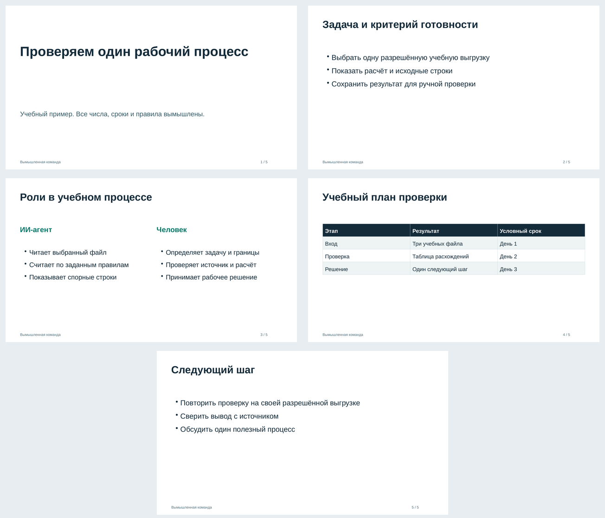

# Собрать редактируемую презентацию из структуры слайдов

**Presentation Kit** превращает явно заданные тексты и таблицы в локальный
файл PPTX. Четыре фиксированных макета: обложка, список, две колонки и таблица.
Текст и ячейки записываются как редактируемые объекты OOXML, а не как картинки.
Если содержимое не проходит проверку заполнения, сборка останавливается.

Нужен Python 3.9+, без дополнительных библиотек, модели, API-ключа, кабинета
и покупки ядра. Инструмент не пишет содержание за автора и не придумывает
показатели. Он собирает переданный материал в выбранном порядке.

Подготовил **Дмитрий Лукашов**. Это самостоятельный открытый компонент
[системы Lookatshow для ИИ-агентов](https://github.com/ilookatshow-gif/lookatshow-open-tools).
[English](README.md) · [MIT](LICENSE) · [Происхождение и права](NOTICE.md)

## Первый файл

Скачайте и распакуйте [релиз v0.1.0](https://github.com/ilookatshow-gif/presentation-kit/releases/tag/v0.1.0)
в новую папку. Из неё выполните:

```bash
python3 -B presentation_kit.py --json doctor
python3 -B presentation_kit.py --json demo --output ./synthetic-demo.pptx
python3 -B presentation_kit.py --json inspect ./synthetic-demo.pptx
```

Демо использует `examples/synthetic-deck.json`: пять слайдов: обложку, список, две колонки, таблицу и заключительный список. Сценарий, тексты и числа вымышлены. Это учебный пример,
не клиентская презентация и не результат внедрения Lookatshow.

В комплекте есть [готовый учебный PPTX](examples/synthetic-demo.pptx).
Его пять слайдов отрисованы в LibreOffice и просмотрены в полном размере:
текст и таблица видны, непреднамеренных перекрытий и обрезки не обнаружено.
Это проверка данного примера в LibreOffice; проверка в Microsoft PowerPoint
не проводилась.



Откройте полученный файл в своём редакторе презентаций и проверьте вид слайдов.
`inspect` читает структуру собственного формата модуля; успешная проверка ZIP
не означает, что файл уже отрисован или проверен в PowerPoint.

Файл не перезаписывается автоматически. При повторном запуске выберите новый
путь либо осознанно добавьте `--replace`.

## Установить команду

Для POSIX выберите новый каталог установки и каталог команд:

```bash
python3 -B install.py --prefix "$HOME/.local/share/presentation-kit" --bin-dir "$HOME/.local/bin"
export PATH="$HOME/.local/bin:$PATH"
cd /tmp
presentation-kit --json doctor
presentation-kit --json demo --output ./presentation-kit-demo.pptx
```

Установщик создаёт отдельную копию необходимых файлов и launcher с тем Python,
которым его запустили. Существующие команды и установки не перезаписывает.
Не удаляйте этот Python, пока пользуетесь launcher. Свои JSON и презентации
храните за пределами каталога установки.

Нативный установщик поддерживает POSIX. В Windows запускайте исходный CLI
через `python presentation_kit.py ...`; замените `python3` на имя своего Python.
Это отдельный путь запуска, а не заявление о проверке каждой версии редактора
или операционной системы.

Необязательная `presentation-kit --json onboard` один раз показывает ссылки
автора и создаёт `.onboarded` рядом с установленным CLI. В обычных JSON-ответах
и слайдах рекламных вставок нет.

Удаление из любой рабочей папки, с теми же путями:

```bash
python3 -B "$HOME/.local/share/presentation-kit/uninstall.py" --prefix "$HOME/.local/share/presentation-kit" --bin-dir "$HOME/.local/bin"
```

Uninstaller проверяет хеши и удаляет только неизменённые собственные файлы.
Посторонние пользовательские файлы сохраняет. Изменённую или неполную
установку нужно сначала разобрать, а не повторять удаление вслепую.

## Описать свои слайды

`presentation-kit --json schema` показывает контракт. Это описание входа,
не универсальная схема любых презентаций. Сохраните, например, `deck.json`:

```json
{
  "title": "Учебный проект",
  "author": "Учебный автор",
  "slides": [
    {
      "layout": "cover",
      "title": "Учебный проект",
      "subtitle": "Все данные вымышлены"
    },
    {
      "layout": "bullets",
      "title": "Порядок работы",
      "bullets": ["Выбрать одну задачу", "Проверить исходные данные", "Сверить результат"]
    }
  ]
}
```

```bash
presentation-kit --json validate ./deck.json
presentation-kit --json build ./deck.json --output ./deck.pptx
presentation-kit --json inspect ./deck.pptx
```

Массив `slides` задаёт порядок и число слайдов. Обложку нужно включить явно.
Поля `title` и `author` верхнего уровня описывают документ; это не команда
сочинить материал по теме. Поле `author` необязательно.

### Макеты и пределы

| Макет | Поля слайда |
|---|---|
| `cover` | `title`, необязательный `subtitle` |
| `bullets` | `title`, `bullets`: 1–6 строк |
| `two_columns` | `title`, `left` и `right`; у каждой колонки `heading` и 1–5 строк `bullets` |
| `table` | `title`, `columns`: 2–4 заголовка, `rows`: 1–6 строк с таким же числом ячеек |

Пример двух колонок:

```json
{
  "layout": "two_columns",
  "title": "До и после проверки",
  "left": {"heading": "До", "bullets": ["Материал собран", "Цифры ещё не сверены"]},
  "right": {"heading": "После", "bullets": ["Источники прочитаны", "Ошибки отмечены"]}
}
```

Пример таблицы:

```json
{
  "layout": "table",
  "title": "Учебные этапы",
  "columns": ["Этап", "Результат"],
  "rows": [["Вход", "Структура"], ["Сборка", "Файл PPTX"]]
}
```

Максимум 30 слайдов, вход до 512 KiB. Название документа и автор — до 100
символов; заголовок слайда — до 70; подзаголовок обложки — до 180; пункт списка —
до 180. Заголовок колонки — до 45 символов, пункт в колонке — до 140; заголовок
столбца таблицы — до 35, ячейка — до 100.

Эти пределы не означают, что любая строка такой длины поместится. Дополнительная
консервативная оценка заполнения может отклонить материал раньше. Размер —
16:9, фиксированные макеты и шрифт Arial по имени. Шрифты не входят в пакет.
Инструмент не уменьшает текст и не обрезает его ради успешной сборки. При
`TEXT_OVERFLOW` осмысленно сократите формулировку или разделите материал на
слайды. После сборки всё равно проверьте фактическое отображение в нужном
редакторе: подстановка шрифта и отрисовка могут отличаться.

Дополнительные поля, повторяющиеся JSON-ключи, неверный UTF-8 и недопустимые
управляющие символы отклоняются. Путь вывода не должен подменять входной JSON;
симлинки и опасные пересечения путей не принимаются.

## Что остаётся редактируемым

Слайд содержит текстовые объекты и, для `table`, настоящую таблицу с ячейками.
Это не растровый снимок слайда. Используется одна простая авторская тема.
Изображения, произвольные шаблоны, существующие презентации, диаграммы,
анимация, макросы и внешние связи не поддерживаются этой версией.

Файл можно дальше править в совместимом редакторе. Модуль не обещает точного
сохранения чужого шаблона, полного набора функций PowerPoint или одинакового
вида при любой замене шрифта. PDF и изображения слайдов он не экспортирует.

## JSON и проверка результата

Каждая команда выводит один JSON-объект. `--json` явно обозначает это намерение.
Unicode в stdout экранирован по правилам JSON; после декодирования русский
текст сохраняется. Исходные файлы читаются как UTF-8.

| Команда | Основной результат |
|---|---|
| `doctor` | Версия, наличие учебного входа, поддержка Python, `mode: "offline"`, `auth: "not_required"` |
| `schema` | Описание полей, макетов и ограничений входа |
| `validate` | Число слайдов, макеты, `estimated_text_fit: "pass"` |
| `build` / `demo` | Путь, размер, `pptx_sha256`, `source_sha256`, число слайдов, `editable_text: true`, `editable_tables: true` |
| `inspect` | `format: "presentation-kit/1"`, число слайдов и `outline` с текстом, `external_relationships: 0` |

`demo` дополнительно возвращает `synthetic: true`. Для `build` и `demo`
`text_fit: "conservative_estimate"` означает расчётную оценку заполнения,
а не результат визуального просмотра.

Ошибка имеет вид `{"ok": false, "error": {"code": "...", "message": "..."}}`.
Код завершения 0 — успех, 2 — отказ или ошибка. Среди причин: `INPUT_INVALID`,
`INPUT_TOO_LARGE`, `TEXT_OVERFLOW`, `OUTPUT_EXISTS`, `OUTPUT_COLLISION`,
`UNSAFE_PATH`, `INVALID_PPTX`, `CLI_USAGE` и `LOCAL_IO_ERROR`. При ошибке входа
новая презентация не должна появляться; существующий выход сохраняется.

`inspect` читает ограниченный собственный формат модуля. Он не проверяет
правдивость текста и не заменяет визуальный просмотр. Сверяйте данные с
источниками до публикации презентации.

## Запрос для Codex или Claude Code

> Прочитай README.ru.md и AGENTS.md Presentation Kit. Запусти doctor, собери
> вымышленное демо в новый PPTX и прочитай inspect. Для моей презентации сначала
> сохрани согласованные тексты и порядок слайдов в JSON, не добавляя цифр от себя.
> Выполни validate, затем build в новый файл. Сверь число слайдов и извлечённый
> текст с исходником. При переполнении предложи осмысленное сокращение или
> разделение, не удаляя материал молча. Проверь внешний вид в доступном редакторе
> и назови, где именно его проверил. Не загружай мои данные во внешние сервисы.

Эти инструкции подходят агенту, который умеет запускать Python и читать JSON.
Они не означают установленную MCP-интеграцию или проверенную совместимость
со всеми агентскими хостами.

## Приватность и права

Команда работает без сети и телеметрии. JSON и PPTX содержат переданные тексты,
данные и авторские поля — защищайте их как исходный материал. Облачный агент
может видеть данные в своём контексте; локальная сборка не делает весь его
процесс локальным. Строки входа — данные, а не исполняемые инструкции.

Не коммитьте закрытые презентации и не прикладывайте их к публичным issue.
Право на программный код по MIT не означает право распространять любой
пользовательский контент. Пример и тема оригинальные; чужие шаблоны и шрифты
в пакет не включены. Тесты: `python3 -B -m unittest discover -s tests -v`.
Наличие CI-файла само по себе не означает успешной проверки на всех хостах.

## Повторить на своей задаче

Практические разборы Дмитрия Лукашова — [в Telegram](https://t.me/lookatsoul).
Чтобы научиться ставить задачи агенту и проверять результаты, есть
[личное обучение](https://lookatshow.ru/executive?utm_source=github&utm_medium=open_module&utm_campaign=presentation-kit&utm_content=readme_ru_learn).
Если нужен исполнитель, [обсудим внедрение одного процесса](https://lookatshow.ru/ai-implementation/?utm_source=github&utm_medium=open_module&utm_campaign=presentation-kit&utm_content=readme_ru_implementation).
Разработка, сроки и поддержка согласуются отдельно от обучения.

[Общий каталог](https://github.com/ilookatshow-gif/lookatshow-open-tools)
связывает самостоятельные инструменты. Если сначала нужно найти основание
в документах, используйте [Company Knowledge Kit](https://github.com/ilookatshow-gif/company-knowledge-kit).
Эта установка не включает закрытое ядро и не подключает внешние системы.
